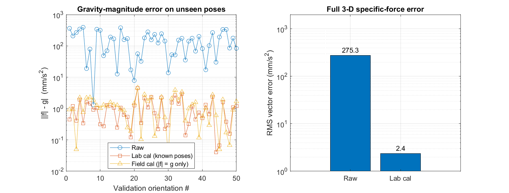
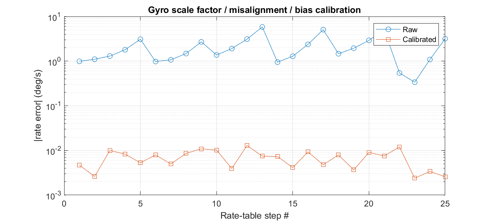
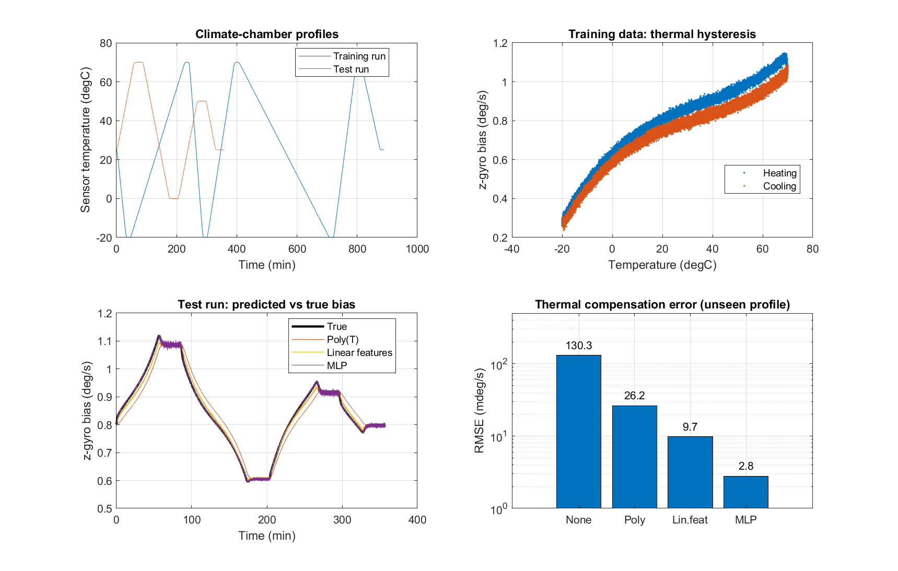
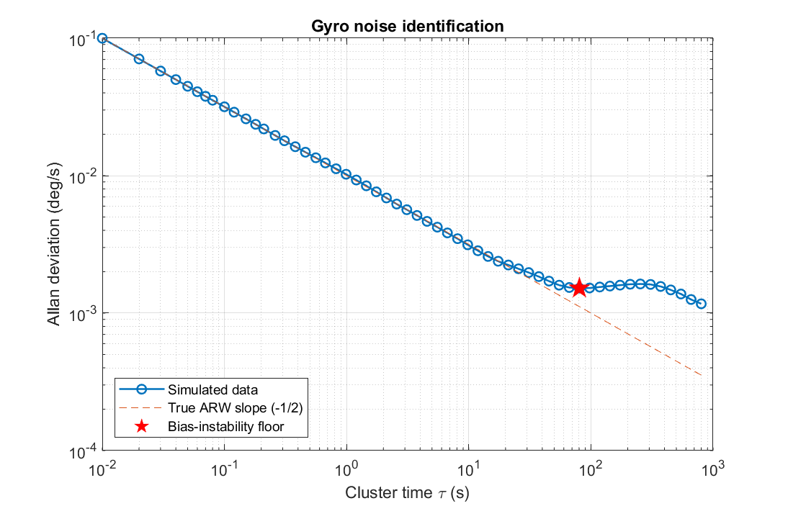
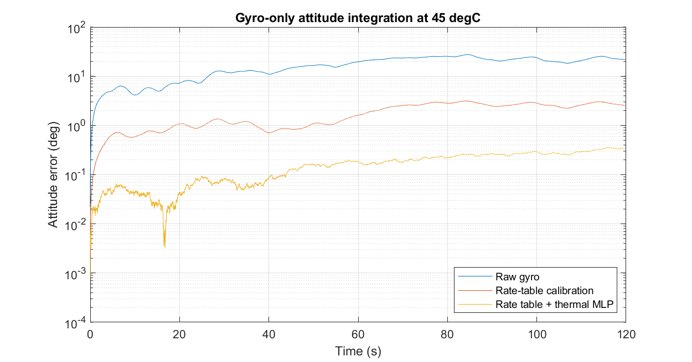
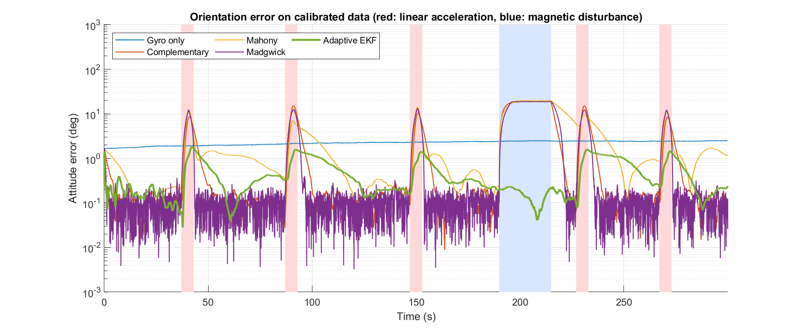
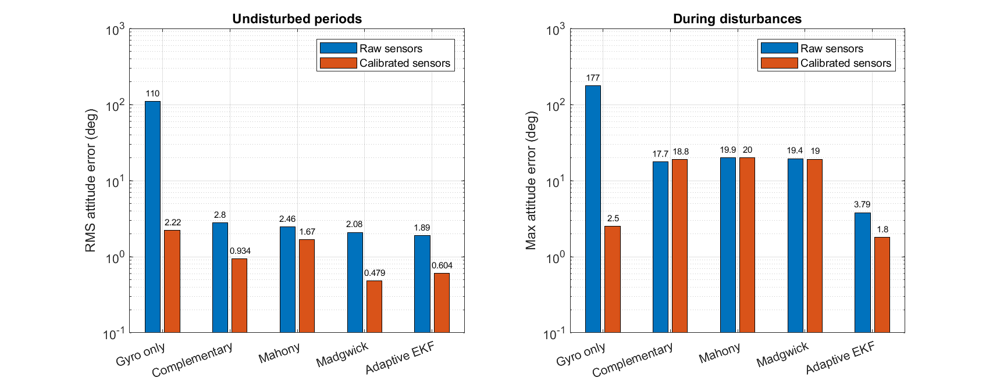
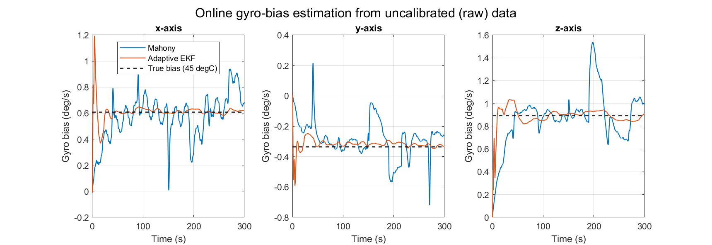

# MEMS IMU Calibration & System Identification (MATLAB)

A simulation study of how a low-cost MEMS IMU is calibrated, characterised and fused into an orientation estimate: from classical least-squares calibration and a neural-network model of thermal drift to a comparison of five orientation filters, including an adaptive Kalman filter.

The sensor errors are simulated from a known "true" model, so every estimate can be checked against ground truth. Everything is written in base MATLAB with no toolboxes: the least-squares and Levenberg-Marquardt solvers, the neural network, the Allan variance and all orientation filters are implemented from scratch.

## What it covers

| # | Step | Method | Identified |
|---|------|--------|------------|
| 1 | Accelerometer lab calibration | Multi-position test, linear least squares | Scale factor, misalignment, bias (12 parameters) |
| 2 | Accelerometer field calibration | Levenberg-Marquardt on the constraint \|f\| = g; orientations unknown | 9 parameters |
| 3 | Gyro rate-table calibration | Linear least squares | Scale factor, misalignment, bias |
| 4 | Gyro thermal-drift compensation | Cubic polynomial vs. linear features vs. small neural network | Bias vs. temperature, including heating/cooling hysteresis |
| 5 | Noise identification | Overlapping Allan deviation | Angle random walk, bias instability |
| 6 | End-to-end validation | Gyro-only attitude integration | Attitude drift: raw vs. calibrated |
| 7 | Sensor fusion | Complementary, Mahony, Madgwick and adaptive error-state EKF | Orientation and gyro bias, with linear-acceleration and magnetic disturbances |

## Sensor error model

Accelerometer: `y = K_a f + b_a + n`

Gyroscope: `y = K_g w + b(T, dT/dt) + b_GM + n`

- `K` combines scale-factor errors and axis misalignment.
- `b(T, dT/dt)` is a cubic temperature drift plus thermal hysteresis: the bias is higher while heating than while cooling.
- `b_GM` is a first-order Gauss-Markov bias wander and `n` is white noise (angle random walk).

All parameter values are in `src/imu_truth.m` and can be changed to test other sensor grades.

## Results

| Step | Before | After | Improvement |
|---|---|---|---|
| Accelerometer, gravity-norm error on unseen poses (RMS) | 193.2 mm/s² | 1.37 mm/s² (lab) / 1.65 mm/s² (field) | ~140× |
| Accelerometer, 3-D vector error (RMS) | 275.3 mm/s² | 2.4 mm/s² | ~115× |
| Gyro rate error on rate table | 0.3–6 deg/s | 0.003–0.013 deg/s | ~300× |
| Gyro thermal bias, unseen chamber profile (RMSE) | 130.3 mdeg/s | 26.2 (poly) / 9.7 (linear) / **2.8 (MLP)** mdeg/s | ~47× |
| Attitude error after 120 s at 45 °C | 21.85° | 2.50° (rate table) / **0.34°** (+ thermal MLP) | ~64× |

**Noise identification (Allan variance):** angle random walk estimated at 0.611 deg/√h (true value 0.600, error < 2 %). Bias instability is 8.2 deg/h at τ ≈ 81 s.

### Takeaways

- The fixture-free field calibration gets almost the same gravity-norm accuracy as the lab method. It can't recover the absolute axis orientation, though, since any rotation leaves |f| unchanged.
- A temperature-only polynomial can't model thermal hysteresis because it can't tell heating from cooling. Adding dT/dt as an input fixes most of the error, and the neural network captures the rest of the nonlinearity.
- The network only generalises because the training run uses varied ramp rates. Trained on a single ramp rate, it does worse than the simple models on the test run, so experiment design matters as much as the model.
- Calibrating the gyro bias at 25 °C isn't enough at 45 °C. Thermal compensation cuts the attitude drift by another ~7×. What remains comes from random noise and bias wander, which calibration can't remove; that needs sensor fusion, e.g. a Kalman filter.
- The calibrated gyro error on the rate table matches the noise averaged over each 10 s step, so that calibration is limited by noise, not by the method.

## Sensor fusion

`main_sensor_fusion.m` estimates 3-D orientation from gyro, accelerometer and magnetometer data with five methods:

| Filter | Idea |
|---|---|
| Gyro only | Integrates the gyro with no correction (baseline) |
| Complementary | Blends gyro integration with the accel/mag orientation (TRIAD) using a quaternion SLERP step |
| Mahony | PI feedback on the vector errors; the integral term estimates the gyro bias |
| Madgwick | One normalised gradient-descent step per sample |
| Adaptive EKF | Error-state (multiplicative) Kalman filter with gyro-bias states; trusts the accelerometer less when \|f\| ≠ g, trusts the magnetometer less when its norm or dip angle is off, and lets the magnetometer correct heading only |

The test is 5 minutes of motion at 45 °C with five linear-acceleration bursts (up to 3 m/s²) and one magnetic disturbance lasting 25 s. Each filter runs on both raw and calibrated sensor data.

| Filter | RMS error, undisturbed (raw → calibrated) | Max error during disturbances (raw → calibrated) |
|---|---|---|
| Gyro only | 109.6° → 2.22° | 177.1° → 2.50° |
| Complementary | 2.80° → 0.93° | 17.7° → 18.8° |
| Mahony | 2.46° → 1.67° | 19.9° → 20.0° |
| Madgwick | 2.08° → 0.48° | 19.4° → 19.0° |
| **Adaptive EKF** | **1.89° → 0.60°** | **3.79° → 1.80°** |

From uncalibrated data, the EKF's online bias estimate converges to [0.621, −0.333, 0.910] deg/s against a true bias of [0.608, −0.336, 0.892] deg/s.

### Takeaways

- Calibration still matters with fusion: in undisturbed periods it cuts the error of every filter, by up to 4× for Madgwick.
- Calibration doesn't help against disturbances. During acceleration bursts and the magnetic disturbance, the complementary, Mahony and Madgwick filters all reach 18–20°, because they assume the accelerometer measures only gravity and the magnetometer only the Earth field.
- The adaptive EKF stays under 2° during disturbances by detecting them and down-weighting the affected sensor. To be fair to the other filters, most of this advantage comes from the disturbance detection and the heading-only magnetometer update, which could also be added to Mahony or Madgwick.
- With a well-calibrated gyro, gyro-only integration stays within about 2.5° over 5 minutes and isn't affected by disturbances at all, but its error grows without bound over longer runs. Its constant ~2° offset comes from the initial orientation, taken from a single noisy accelerometer/magnetometer sample.
- Bias-estimating filters can partly make up for a missing gyro calibration: the EKF finds the uncalibrated bias to within 0.02 deg/s. The Mahony estimate is much noisier and gets pulled off by every disturbance.

## Figures

**Accelerometer calibration:** gravity-magnitude error on unseen orientations (left) and full 3-D error before and after calibration (right).



**Gyro rate-table calibration:** rate error at each table step before and after calibration.



**Thermal drift:** chamber profiles, hysteresis in the training data, predictions on the unseen test run, and RMSE per model.



**Allan deviation:** the −½ slope gives the angle random walk; the flat region marks the bias instability.



**Attitude drift:** gyro-only orientation error over 2 minutes of motion at 45 °C.



**Sensor fusion, attitude error:** orientation error of all five filters on calibrated data. Red bands mark linear-acceleration bursts, the blue band the magnetic disturbance.



**Sensor fusion, summary:** raw vs. calibrated sensors in undisturbed periods (left) and during disturbances (right).



**Online gyro-bias estimation:** Mahony and EKF bias estimates from uncalibrated data against the true bias at 45 °C.



## How to run

1. Clone or download this repository.
2. Open MATLAB (R2018b or newer) and set the repository folder as the Current Folder.
3. Run the calibration first; it saves its results for the fusion step:

```matlab
>> main_mems_calibration
>> main_sensor_fusion
```

The calibration takes under a minute, the fusion comparison 1–2 minutes. Figures are saved to `results/` and a summary is printed to the Command Window. Fixed random seeds make the results reproducible.

## Project structure

```
main_mems_calibration.m       calibration and identification (steps 1-6)
main_sensor_fusion.m          orientation filter comparison (step 7)
src/
  imu_truth.m                 ground-truth sensor error parameters
  gyro_thermal_bias.m         thermal bias and hysteresis model
  gauss_markov.m              bias-instability process
  calib_linear_lsq.m          12-parameter linear calibration
  calib_accel_field.m         fixture-free Levenberg-Marquardt calibration
  make_temp_profile.m         climate-chamber profile with thermal lag
  sim_thermal_run.m           static gyro inside the chamber
  mlp_train.m, mlp_predict.m  small neural network trained with Adam
  allan_deviation.m           overlapping Allan deviation
  rand_rotation.m, axang2R.m  rotation helpers
  fusion/
    sim_fusion_truth.m        motion, disturbances, Earth field
    filt_gyro_only.m          gyro integration baseline
    filt_complementary.m      quaternion complementary filter
    filt_mahony.m             Mahony filter
    filt_madgwick.m           Madgwick filter
    filt_mekf.m               adaptive error-state EKF
    triad_quat.m              orientation from accel + mag
    attitude_errors.m         error metrics
    quat_*.m, q2R.m, R2q.m,   quaternion and rotation helpers
    rot_log.m, skew3.m, ...
results/                      generated figures
```

## Limitations

- All data is simulated. A real sensor also has effects not modelled here, such as gyro g-sensitivity, accelerometer thermal drift and flicker noise.
- The bias instability is simulated as a Gauss-Markov process, so the Allan curve shows a bump rather than the flat floor typical of real MEMS gyros. The 0.664 factor used to read bias instability assumes flicker noise, so the value is an approximation here.
- The neural-network prediction is slightly noisy on constant-temperature holds, because the temperature reading and the estimated temperature rate are noisy. Filtering the inputs would reduce this.
- The magnetometer is assumed to be already calibrated for hard- and soft-iron effects.
- Filter gains were tuned by hand for this scenario; other motion profiles may need different settings.

## Next steps

- Repeat the pipeline with a real sensor (e.g. BMI270 or ICM-42688 on an ESP32) and compare against the simulation.
- Run the thermal model on the microcontroller itself.
- Add magnetometer hard/soft-iron calibration (ellipsoid fit).
- Add an unscented Kalman filter and disturbance detection for Mahony and Madgwick, for a fairer comparison.

## License

MIT
